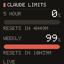

# keyboard-screen

Puts the Claude **5-hour** and **weekly** subscription limits on the 128x128
screen of an Epomaker x Aula F75 Max.



## How it gets the numbers

The figures come off the `anthropic-ratelimit-unified-*` response headers of a
tiny `/v1/messages` ping — about 9 tokens of Haiku 4.5 — authenticated with the
OAuth token Claude Code already stores in `~/.claude/.credentials.json`.

**This spends subscription quota, never API credits.** The only credential the
program will send is a Claude Code OAuth access token (`sk-ant-oat…`); it never
reads `ANTHROPIC_API_KEY`, never sets an `x-api-key` header, and refuses to send
anything it does not recognise rather than guessing which account pays. It
refreshes the OAuth token when it expires and writes it back atomically at
`0600`, preserving every other key in the file.

Two consequences worth knowing:

* The headers are **account-wide**, so the screen also reflects usage from
  claude.ai or another machine — which is the point.
* A ping **opens a 5-hour window** if none is running, so watching around the
  clock keeps one open.

Claude Code's own `~/.claude/usage-exact.json` is only used as a last-resort
fallback: it is refreshed when Claude Code feels like it, not when you ask, so
it goes stale. The footer always says which source the numbers came from and how
old they are — `LIVE`, `CACHED 4M`, or `CC FILE 2H30M` — so a frozen screen
cannot pass for a live one.

## Build

```sh
cargo build --release
install -Dm755 target/release/keyboard-screen ~/.local/bin/keyboard-screen
```

## Permissions

```sh
sudo cp udev/99-aula-f75max.rules /etc/udev/rules.d/
sudo udevadm control --reload && sudo udevadm trigger
```

Replug the keyboard afterwards.

## Use

```sh
keyboard-screen                  # refresh once and push to the screen
keyboard-screen --watch 60       # keep it updated (60s minimum)
keyboard-screen --dry-run -o /tmp/f.ppm   # render without a keyboard attached
keyboard-screen --no-refresh     # draw from cache; spend nothing
keyboard-screen --slot 2         # write a different display slot (1-255)
```

Run it continuously with the bundled unit:

```sh
install -Dm644 systemd/keyboard-screen.service ~/.config/systemd/user/
systemctl --user enable --now keyboard-screen
```

## The screen protocol

The keyboard (`0c45:800a`, SONiX) exposes two vendor HID interfaces. The screen
is **wired-only** — over the 2.4GHz dongle the usage pages differ.

| Usage page | Report | Role |
|---|---|---|
| `0xff13` | 64-byte feature | command channel |
| `0xff68` | 4096-byte output | raw pixel channel |

Upload sequence:

1. `04 18` on the command channel — begin.
2. `04 72` with the slot at byte 2 and the chunk count as a little-endian
   `u16` at bytes 8–9.
3. The payload as 4096-byte output reports, each followed by a 128-byte ACK.
4. `04 02` — commit. **The screen does not change until this arrives.**

The payload is a 256-byte header (frame count, then one delay byte per frame)
followed by `frames × 128 × 128 × 2` bytes of **little-endian RGB565**, zero
padded to a multiple of 4096. A still image is one frame — 9 chunks.

Protocol credit: reverse-engineered by the
[Aula-F75-Max-Driver](https://github.com/VitalyArt/Aula-F75-Max-Driver) and
[Aula-F75-Max-OSX](https://github.com/RoseWaveStudio/Aula-F75-Max-OSX) projects.

## Layout

Dependencies are `libc` (raw `ioctl`/`getrandom`) and `ureq`+`rustls` for the
HTTPS ping. The JSON parser, the 5×7 font, the drawing primitives and the HID
transport are all in-tree.

| File | Role |
|---|---|
| `src/hid.rs` | hidraw discovery and raw feature/output reports |
| `src/display.rs` | the upload sequence and payload encoding |
| `src/canvas.rs` | 128×128 canvas, drawing, RGB565 packing |
| `src/font.rs` | 5×7 bitmap font |
| `src/render.rs` | dashboard layout |
| `src/api.rs` | OAuth token handling and the usage ping |
| `src/state.rs` | snapshot provenance and the fallback chain |
| `src/json.rs` | minimal JSON parser/serializer |

## Wireless

The screen is **wired-only** in practice.

The 2.4GHz dongle (`05ac:024f` — it reports Apple's vendor id, so `lsusb` calls
it an Apple keyboard) does expose two vendor pages: `0xff59` command, 64-byte
reports, and `0xff60` raw, **32-byte** reports. That 32 is the obstacle — wired,
the raw pipe is 4096 bytes, so a frame is 9 chunks; wireless it would be ~1032
packets, and the `04 72` metadata packet counts chunks in 4096-byte units. The
wired framing cannot be what the firmware expects over the air.

The wireless protocol is also a different vocabulary, not the wired one on a
narrower pipe: 32-byte packets, opcodes `05`/`07`/`0f`/`20`, an `aa 55` marker
and a checksum at byte 31. Every open-source driver implements only RGB,
battery, and settings over wireless, and gates image upload on a wired link.

Over Bluetooth it is not merely unimplemented: the vendor software refuses it
too — its own UI string reads *"keyboard settings are not supported in Bluetooth
mode for now. Please use the USB or 2.4 GHz connection."*

The vendor software does treat 2.4GHz as a full mode (`config.xml` declares
`mode value="2"` for the dongle at `05AC:024F`, interface `MI_03`), and its HID
write takes the transfer length from the open interface's report length at
runtime rather than a hardcoded 4096 — so one upload path plausibly serves both
transports. On that basis `--wireless` reuses the wired opcodes against the
wireless channels.

**It does not work.** The writes are accepted by the kernel and silently
discarded by the firmware. The likely reason: every known-working wireless
operation (battery, RGB, key settings) goes over `0xff60` with a different
envelope — 32 bytes, an `aa 55` marker, and a checksum at byte 31 — and its own
opcode space (`05` RGB, `07` keys, `0f` commit, `20` battery). The wired display
commands have neither the envelope nor a known opcode here, so they fail
validation. Recovering the real one needs decompilation or a USB capture of the
vendor software, not extrapolation.

`--probe-write` isolates the remaining question by driving the RGB over 2.4GHz
with documented opcodes: if the lighting responds, wireless writes reach the
firmware and only the display opcode is unknown; if not, the dongle does not
accept host commands at all.

`--probe-wireless` investigates the dongle read-only. It writes exactly one
thing — the battery query documented by the existing drivers — and otherwise
just listens. It deliberately does not fire wired `04 xx` opcodes at the
wireless channel: they are undefined there, and their wired neighbours
(`04 19`, `04 15`, `04 11`) are the factory-reset sequence.

Run it with the keyboard switched to 2.4G mode; a battery reply means the
channel is live and the image path is worth reverse-engineering from a USB
capture of the vendor software.

### Confirmed wireless findings

Established on real hardware with `--probe-write`:

* **The keyboard acts on wireless host writes.** Driving the RGB over `0xff60`
  with the documented packets changes the lighting, so the 32-byte envelope —
  `aa 55` marker, checksum at byte 31 — is validated and accepted. Only the
  *display* opcode remains unknown.
* **Wireless RGB byte order is R, G, B at bytes 4, 5, 6.** The existing
  open-source drivers put blue in byte 4 and red in byte 6, which renders red
  and blue swapped. Green sits in the middle either way, which is what makes the
  error easy to overlook.
